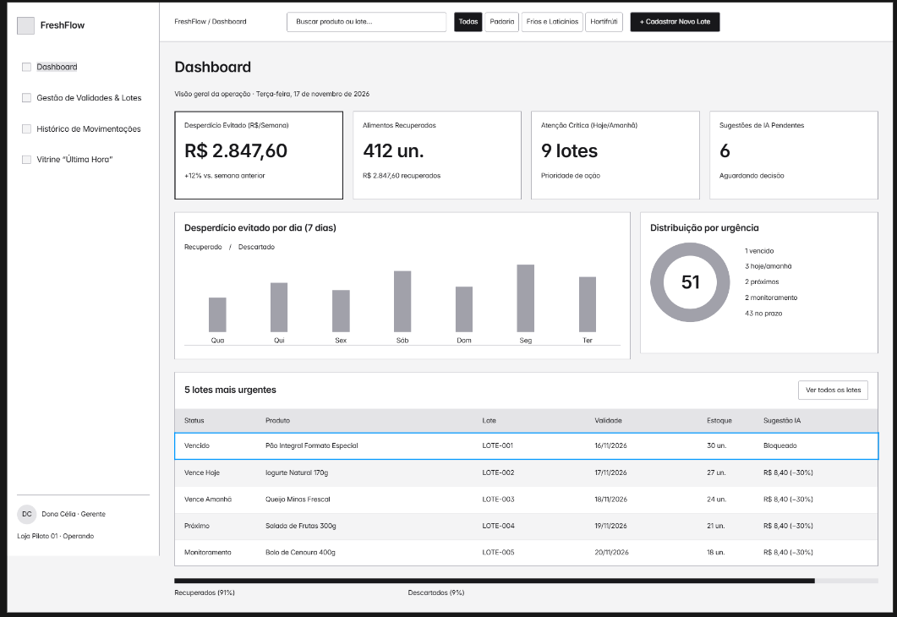
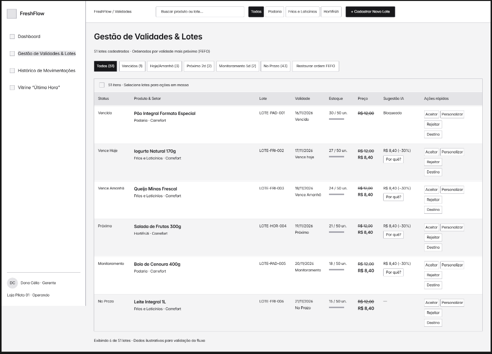
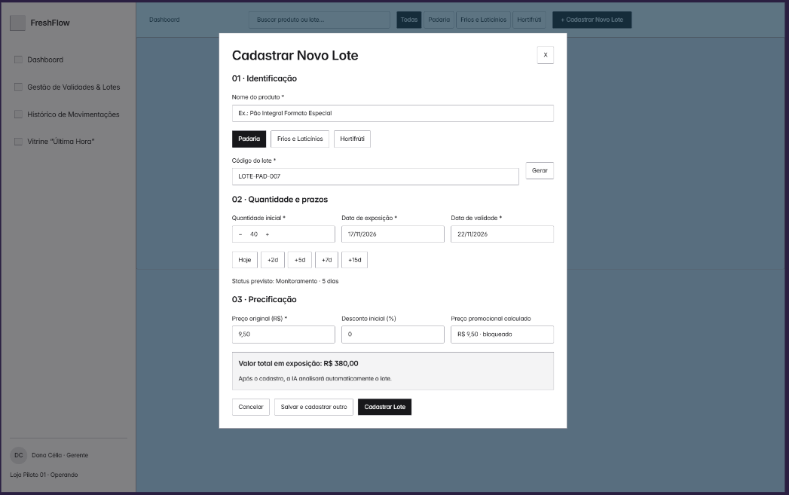
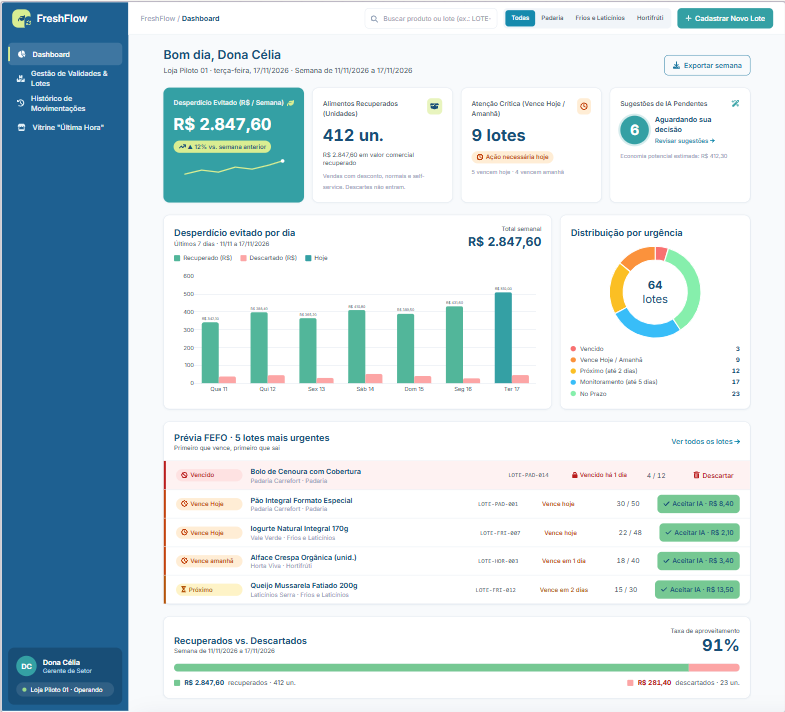
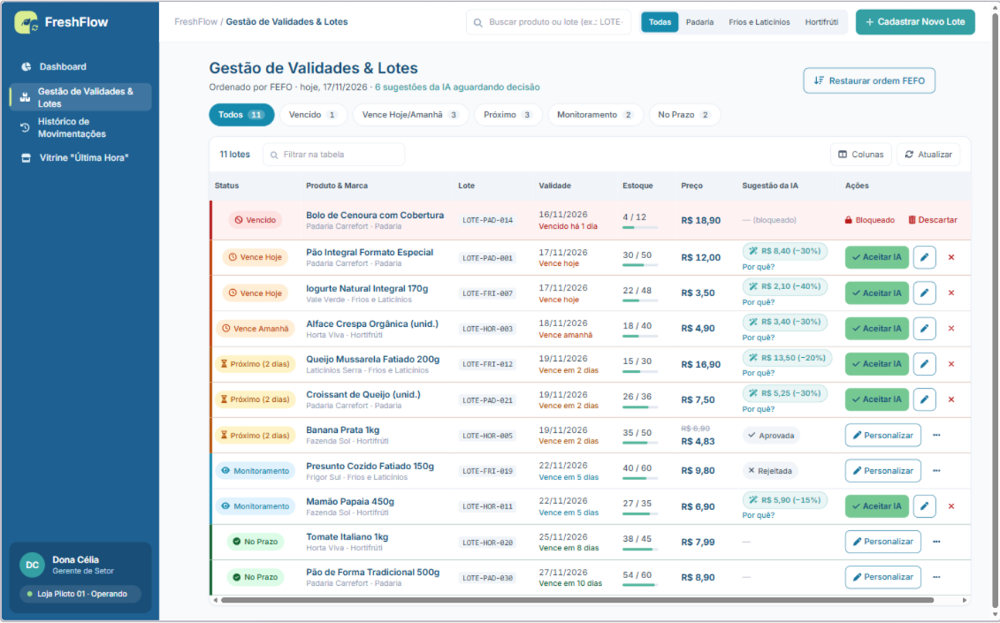
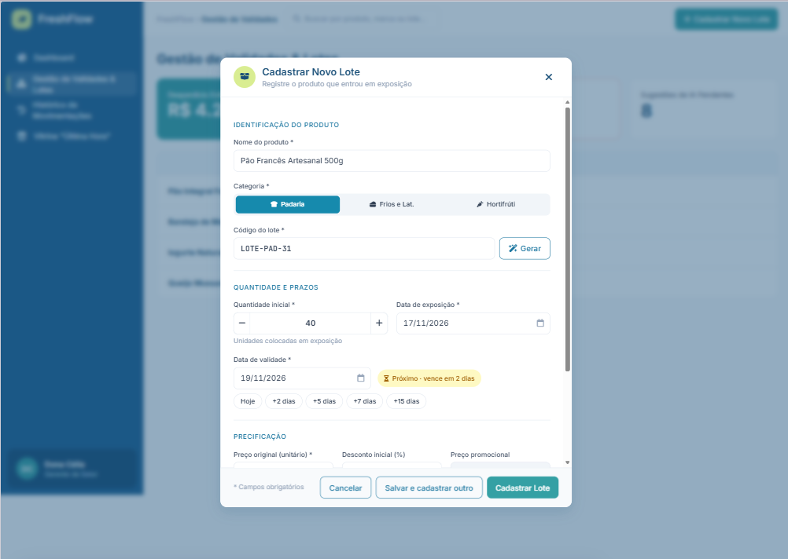

# 🎨 UX/UI Design — FreshFlow

Documentação do trabalho de design de interface do projeto **FreshFlow**: ferramentas, prompt utilizado, o que a IA entregou e o que foi ajustado durante a construção.

---

## 👤 Membro da equipe

| Item | Informação |
|---|---|
| **Nome** | Douglas Araujo |
| **Função** | UX/UI Design |
| **GitHub** | [@dgarauj04](https://github.com/dgarauj04) |

---

## 🛠️ Ferramentas utilizadas

| Ferramenta | Finalidade |
|---|---|
| **Claude (Anthropic)** | Apoio com IA para estruturar e refinar o **Prompt Mestre de Design** (design system, cores, layout, componentes e dados de mockup) |
| **Framer** | Geração das telas do wireframe a partir do prompt de design da ideia do pojeto |
| **UX Pilot** | Criação do design final com O Prompt Mestre de Design (Componentes, fontes, cores, espaçamentos, ícones e imagens definitivos) |

---
# 📝 Prompt utilizado para criação do Wireframe

<details>
<summary><strong>Clique para expandir o prompt completo</strong></summary>

```markdown
# SYSTEM ROLE & OBJETIVO DO WIREFRAME
Atue como um Arquiteto de Informação e UX Designer Sênior. Sua tarefa é gerar os **wireframes estruturais (baixa/média fidelidade)** do sistema web **FreshFlow** (plataforma de gestão de validade FEFO e precificação dinâmica com IA para supermercados).

**RESTRIÇÕES ESTRITAS DE ESTILO (WIREFRAME PURO):**
* **Sem estética final:** NÃO utilize paleta de cores da marca, gradientes, sombras elaboradas, fotos realistas ou estilos decorativos.
* **Aparência:** Utilize estritamente **escala de cinza** (branco `#FFFFFF`, cinzas claros `#F4F4F5` / `#E4E4E7`, bordas finas `#A1A1AA` e texto escuro `#18181B`), formas geométricas básicas (retângulos, círculos, linhas), placeholders com "X" ou ícones esquemáticos simples e tipografia padrão sem serifa.
* **Foco absoluto:** Hierarquia visual, densidade de informação, espaçamento (grid 1440×900 desktop), fluxos de interação e funcionalidade dos componentes. Idioma dos rótulos: **Português (BR)**.

---

# 1. ESTRUTURA GLOBAL (APP SHELL - 1440×900)
Desenhe um layout estrutural dividido em 3 zonas fixas:

1. **Sidebar Esquerda (Largura 248px, borda direita de 1px):**
   * **Topo:** Placeholder retangular para Logo + Texto "FreshFlow".
   * **Menu Vertical (4 itens com ícone esquemático + rótulo, destacando o item ativo com borda/fundo cinza médio):**
     1. Dashboard
     2. Gestão de Validades & Lotes
     3. Histórico de Movimentações
     4. Vitrine "Última Hora"
   * **Rodapé da Sidebar:** Bloco de perfil com círculo para avatar ("DC"), texto "Dona Célia · Gerente" e indicador de status "Loja Piloto 01 · Operando".

2. **Header Superior (Altura 64px, borda inferior de 1px, alinhado à direita da sidebar):**
   * Da esquerda para a direita:
     * **Breadcrumb:** `FreshFlow / [Nome da Tela Atual]`.
     * **Campo de Busca:** Input retangular (~320px) com placeholder `"Buscar produto ou lote..."`.
     * **Controle Segmentado (Filtro de Setor):** 4 botões agrupados (`Todas` [ativo] | `Padaria` | `Frios e Laticínios` | `Hortifrúti`).
     * **Botão de Ação Primária:** Retângulo sólido escuro com rótulo `"+ Cadastrar Novo Lote"`.

3. **Área Dinâmica Principal (Largura fluida até 1152px, padding 24px):**
   * Conteúdo variável conforme as 5 telas/estados detalhados abaixo.

---

# 2. TELAS E FLUXOS A SEREM DESENHADOS

## TELA 1: Dashboard (Visão Geral)
* **Linha 1 — Faixa de 4 Cards de KPI (Grid 4 colunas, clicáveis):**
  * **Card 1 (Destaque com borda reforçada):** Título "Desperdício Evitado (R$/Semana)", número grande `"R$ 2.847,60"`, tag `"▲ 12% vs. semana anterior"` e espaço para mini gráfico de linha (sparkline).
  * **Card 2:** "Alimentos Recuperados", número `"412 un."`, subtexto `"R$ 2.847,60 recuperados"`.
  * **Card 3:** "Atenção Crítica (Hoje/Amanhã)", número `"9 lotes"`, tag de alerta.
  * **Card 4:** "Sugestões de IA Pendentes", número `"6"`, subtexto `"Aguardando decisão"`.
* **Linha 2 — Área de Gráficos (Grid assimétrico 2/3 + 1/3):**
  * **Bloco Esquerdo (2/3):** Box com título "Desperdício evitado por dia (7 dias)", placeholder de gráfico de barras verticais e legenda (`Recuperado` vs. `Descartado`).
  * **Bloco Direito (1/3):** Box com título "Distribuição por urgência", placeholder de gráfico de rosca (donut) com total no centro e legenda lateral.
* **Linha 3 — Prévia Operacional:**
  * Box estruturado contendo uma mini-tabela com os **5 lotes mais urgentes** e link à direita `"Ver todos os lotes →"`.
* **Rodapé da Área:** Barra horizontal proporcional comparando `"Recuperados (91%)"` vs. `"Descartados (9%)"`.

## TELA 2: Gestão de Validades & Lotes (Tabela FEFO)
* **Barra de Filtros Rápidos (Chips horizontais acima da tabela):**
  * `Todos (51)` | `Vencidos (1)` | `Vence Hoje/Amanhã (3)` | `Próximo 2d (2)` | `Monitoramento 5d (2)` | `No Prazo (43)` + botão à direita `"Restaurar ordem FEFO"`.
* **Toolbar da Tabela:** Checkbox de seleção em lote, contador de itens e barra de ações em massa ocultável (`"X selecionados · Aceitar IA em lote · Descartar"`).
* **Tabela Estrutural (8 Colunas com cabeçalho fixo):**
  1. **Status:** Tag retangular/pill com ícone esquemático + texto (`Vencido`, `Vence Hoje`, `Próximo`, `Monitoramento`, `No Prazo`).
  2. **Produto & Setor:** Título em negrito (ex: `Pão Integral Formato Especial`) + subtexto (`Padaria · Padaria Carrefort`).
  3. **Lote:** Código `LOTE-PAD-001`.
  4. **Validade:** Data `17/11/2026` + subtexto `Vence hoje`.
  5. **Estoque:** Texto `30 / 50 un.` + barra linear simples de progresso abaixo.
  6. **Preço:** Preço original riscado (quando aplicável) + preço atual em destaque.
  7. **Sugestão IA:** Tag destacada com borda tracejada ou cinza médio (`R$ 8,40 (-30%)`) + link `"Por quê?"` (que abre popover explicativo). Para itens vencidos ou no prazo, exibir `"—"` ou `"Bloqueado"`.
  8. **Ações Rápidas:** Grupo compacto com 3 botões pequenos (`[Aceitar]`, `[Personalizar]`, `[Rejeitar]`) + botão dropdown `[⋯ Destino]` (que abre menu vertical com: *Venda Normal, Aplicar Desconto, Self-Service, Descartar*).
* *Nota de Estado:* Representar também o **Popover inline de "Personalizar Preço"** (aberto sobre uma linha), contendo input de `Preço (R$)`, input de `Desconto (%)`, preview do cálculo e botões `[Cancelar]` e `[Confirmar]`.

## TELA 3: Histórico de Movimentações
* **Barra de Filtros:** Dropdowns para `Período`, `Tipo de Ação`, `Operador` + botão `[Exportar Relatório]`.
* **Tabela de Auditoria (6 Colunas):**
  * `Data/Hora` | `Produto` | `Lote` | `Ação Executada` (tag textual: *Preço alterado pela IA, Preço personalizado, Sugestão rejeitada, Venda normal, Self-Service, Descartado*) | `Operador` (`Dona Célia`) | `Impacto Financeiro` (`+ R$ 96,60` ou `- R$ 75,60`).
* **Rodapé:** Controles simples de paginação (`< 1 2 3 >`).

## TELA 4: Vitrine "Última Hora" (Visão do Consumidor)
* **Banner Superior:** Faixa discreta no topo `"Pré-visualização do Cliente"` + bloco de cabeçalho com título `"Ofertas da Última Hora"`, subtítulo explicativo e chips de filtro por categoria (`Todas`, `Padaria`, `Frios e Laticínios`, `Hortifrúti`).
* **Grid de Produtos (4 colunas):**
  * Desenhar 4 a 6 cards esquemáticos. Cada card contém:
    * Caixa retangular com "X" (placeholder de foto do produto) + tag no canto superior direito `"-30%"`.
    * Nome do produto e marca.
    * Preço antigo riscado (`R$ 12,00`) + Preço promocional grande (`R$ 8,40`).
    * Rodapé do card com ícone de relógio `"Válido até 17/11"` e `"Restam 30 un."`.

## OVERLAY / MODAL: Cadastrar Novo Lote
* Desenhar como janela centralizada (largura 640px) sobre fundo escurecido/desfocado:
  * **Header:** Título `"Cadastrar Novo Lote"` + botão fechar `[X]`.
  * **Seção 1 (Identificação):** Input `Nome do produto *`, Seletor segmentado `Setor *` (3 opções), Input `Código do lote *` + botão `[Gerar]`.
  * **Seção 2 (Quantidade e Prazos):** Stepper numérico `Quantidade inicial *` (`[-] 40 [+]`), Date picker `Data de exposição *`, Date picker `Data de validade *` com chips de atalho abaixo (`Hoje`, `+2d`, `+5d`, `+7d`, `+15d`) + Tag de prévia dinâmica de status ao lado.
  * **Seção 3 (Precificação):** Inputs lado a lado para `Preço original (R$) *`, `Desconto inicial (%)` e campo bloqueado `Preço promocional calculado`.
  * **Bloco de Resumo:** Caixa retangular informando `"Valor total em exposição: R$ 380,00"` + nota informativa sobre análise automática da IA.
  * **Rodapé do Modal:** Botões `[Cancelar]`, `[Salvar e cadastrar outro]` e `[Cadastrar Lote].
  ```

</details>

## 🎯 Objetivo do prompt

Gerar os **wireframes estruturais (baixa e média fidelidade)** do FreshFlow antes da definição da identidade visual, para validar com a equipe a **organização da informação, a hierarquia e os fluxos de interação** sem a influência de cores ou estilos decorativos.

O prompt foi construído para:

- **Isolar a estrutura do estilo:** a IA foi instruída a usar apenas escala de cinza, formas geométricas básicas, placeholders com "X" e tipografia sem serifa, sem paleta de marca, gradientes, sombras ou fotos.
- **Definir um App Shell consistente** em 1440×900, com sidebar fixa de 248px, header de 64px e área dinâmica de até 1152px.
- **Cobrir as telas essenciais do MVP:** Dashboard, Gestão de Validades & Lotes (tabela FEFO), Histórico de Movimentações, Vitrine "Última Hora" e o modal de Cadastrar Novo Lote.
- **Detalhar a funcionalidade dos componentes**, como KPIs clicáveis, filtros por urgência, ações em lote, menu de destino operacional, popover de "Personalizar Preço" e prévia dinâmica de status de validade.
- **Priorizar a persona Dona Célia**, gerente de setor, que precisa auditar validades e decidir sobre as sugestões da IA com poucos cliques.
- **Usar dados realistas em português** (valores, lotes, datas e contagens) para que o wireframe já mostre a densidade real de informação.

---

## 🤖 O que a IA entregou

A partir do prompt, a ferramenta gerou os wireframes em escala de cinza com:

- **App Shell global:** sidebar fixa com logo placeholder, 4 itens de navegação e bloco de perfil da Dona Célia; header com breadcrumb, busca, filtro segmentado por setor e botão "+ Cadastrar Novo Lote".
- **Dashboard:** 4 cards de KPI (com destaque para Desperdício Evitado), áreas de gráfico de barras e rosca, mini-tabela com os 5 lotes mais urgentes e barra comparando Recuperados e Descartados.
- **Gestão de Validades & Lotes:** chips de filtro por urgência com contagem, toolbar com seleção em lote, tabela FEFO de 8 colunas (status, produto e setor, lote, validade, estoque, preço, sugestão da IA e ações rápidas) e o popover de "Personalizar Preço".
- **Histórico de Movimentações:** filtros, tabela de auditoria com 6 colunas e paginação.
- **Vitrine "Última Hora":** faixa de pré-visualização, filtros por categoria e grid de cards com placeholder de imagem, selo de desconto, preço riscado e validade.
- **Modal de Cadastrar Novo Lote:** formulário dividido em 3 seções, chips de atalho de validade, prévia de status, bloco de resumo e botões de ação.

---

## 🖼️ Imagens do Wireframe
### Wireframe do Dashboard


### Wireframe da Gestão de Validades e Lotes (FEFO)


### Wireframe Cadastro de Lote / Produto


---
</br></br>


# 📝 Prompt Mestre utilizado para criação do Design final:

<details>
<summary><strong>Clique para expandir o prompt completo</strong></summary>

```markdown
Você é um Arquiteto de UI/UX e Product Designer sênior especializado em dashboards operacionais B2B (SaaS). Projete a interface completa do **FreshFlow**, um sistema web de gestão de validade (método FEFO – First Expired, First Out) com precificação dinâmica sugerida por IA, para supermercados.

**Contexto:** A rede Carrefort (40 lojas) perde alimentos perecíveis (Padaria, Frios e Laticínios, Hortifrúti) porque controla validade em planilhas impressas. As lojas têm estoque enxuto: o próprio salão de vendas funciona como estoque. O sistema monitora o que está em exposição, alerta sobre o que está perto de vencer e permite agir antes da perda.

**Persona:** Dona Célia, gerente de setor. Audita validades no fim do turno, aprova sugestões de desconto da IA e registra o destino dos lotes com poucos cliques. A interface precisa ser extremamente ágil, escaneável e sem ambiguidade.

**Objetivo central:** Responder visualmente, no primeiro olhar do dashboard: *"Quanto desperdício (em R$ e unidades) foi evitado por semana nesta loja?"*

**Fluxo principal a ser desenhado:**
Produto em exposição → sistema monitora validade → IA sugere preço → gerente decide (Aceitar / Personalizar / Rejeitar) → lote recebe destino (Venda Normal, Oferta, Self-Service, Descarte) → impacto financeiro registrado no histórico e no dashboard.

**Entregáveis visuais:** 4 telas desktop (1440×900) dentro de um App Shell consistente: (1) Dashboard, (2) Gestão de Validades & Lotes, (3) Histórico de Movimentações, (4) Vitrine "Última Hora" (visão do consumidor). Inclua também os estados dos componentes interativos descritos abaixo. Idioma de toda a interface: **português do Brasil**. Moeda: R$ com vírgula decimal (ex.: R$ 8,50). Datas: DD/MM/AAAA.

---

# 2. DESIGN SYSTEM

## 2.1 Cores (tokens exatos)

**Paleta de marca**
| Token | Hex | Uso |
|---|---|---|
| `--lime-cream` | `#D9ED92` | Destaques suaves, badges de oportunidade/economia |
| `--light-green` | `#B5E48C` | Fundos de sucesso, indicadores positivos |
| `--light-green-2` | `#99D98C` | Status saudável / "No prazo" |
| `--emerald` | `#76C893` | Ações positivas, botão "Aceitar IA", preço promocional na vitrine |
| `--ocean-mist` | `#52B69A` | Ícones ativos, elementos de apoio |
| `--tropical-teal` | `#34A0A4` | Botões primários, CTAs da IA, card principal de KPI |
| `--bondi-blue` | `#168AAD` | Links, filtros ativos, destaques interativos |
| `--cerulean` | `#1A759F` | Cabeçalhos secundários, bordas de foco |
| `--baltic-blue` | `#1E6091` | Sidebar / navegação principal |
| `--yale-blue` | `#184E77` | Texto principal escuro, títulos, elementos fixos |

**Neutros**
- `--bg-app`: `#F8FAFC` (fundo da área de trabalho)
- `--surface`: `#FFFFFF` (cards, tabelas, modais)
- `--border`: `#E2E8F0` (bordas e divisores)
- `--text-primary`: `#184E77`
- `--text-secondary`: `#475569`
- `--text-muted`: `#94A3B8`

**Cores de status crítico de validade (uso exclusivo para urgência; sempre suaves, nunca saturadas)**
| Status | Fundo | Texto/Borda |
|---|---|---|
| Vencido | `#FEE2E2` | `#B91C1C` |
| Vence Hoje / Amanhã | `#FFEDD5` | `#C2410C` |
| Próximo (até 2 dias) | `#FEF3C7` | `#B45309` |
| Monitoramento (até 5 dias) | `#E0F2FE` | `#168AAD` |
| No Prazo | `#DCFCE7` com `--light-green-2` | `#166534` |

Regra: vermelho e âmbar aparecem **somente** em status de validade e alertas críticos. Nunca em botões comuns ou decoração. Não depender só de cor: todo status leva **ícone + texto**.

## 2.2 Tipografia
- Família: **Inter** (fallback: system-ui, sans-serif). Números tabulares (`tabular-nums`) em preços, quantidades e KPIs.
- Escala: Display KPI 32/40 Bold · H1 24/32 Semibold · H2 18/28 Semibold · Corpo 14/20 Regular · Tabela 13/18 Regular · Label/Badge 12/16 Medium (caixa normal) · Legenda 11/14.
- Títulos e números de destaque em `--yale-blue`; corpo em `--text-secondary`.

## 2.3 Espaçamento, forma e elevação
- Grid base de **4px**; escala: 4, 8, 12, 16, 24, 32, 48.
- Raio: **8px** (inputs, botões, badges) e **12px** (cards, modais, painéis). Badges em formato pill (999px).
- Sombras: cards `0 1px 3px rgba(24,78,119,0.08)`; popovers/menus `0 8px 24px rgba(24,78,119,0.16)`. Sem sombras pesadas.
- Bordas 1px `--border`. Foco de teclado: anel 2px `--cerulean` com offset 2px.
- Ícones: traço linear 20px (estilo Lucide/Feather), espessura 1.75.

## 2.4 Componentes base
- **Botão primário:** fundo `--tropical-teal`, texto branco, altura 40px, hover escurece 8%.
- **Botão de aprovação ("Aceitar IA"):** fundo `--emerald`, texto `--yale-blue`, ícone de check.
- **Botão secundário:** contorno 1px `--cerulean`, texto `--cerulean`, fundo transparente.
- **Botão destrutivo/ghost ("Rejeitar", "Descartar"):** texto `#B91C1C`, fundo transparente; hover fundo `#FEE2E2`.
- **Input/Select:** altura 40px, borda `--border`, foco com borda `--cerulean`.
- **Badge:** pill, 12px Medium, ícone 14px à esquerda.
- **Estados obrigatórios:** default, hover, focus, active, disabled, loading (skeleton ou spinner), vazio (ilustração simples + texto + CTA) e erro.
- **Acessibilidade:** contraste mínimo WCAG AA (4.5:1 em texto), alvos de clique ≥ 36px, ordem de tabulação lógica.

---

# 3. ARQUITETURA DE LAYOUT

Estrutura **App Shell** em 1440×900: sidebar fixa à esquerda + coluna de conteúdo com header superior fixo e área dinâmica rolável. A área dinâmica troca conforme o item de navegação ativo.

## 3.1 Sidebar (fixa, 248px, fundo `--baltic-blue`; a seção de perfil pode usar `--yale-blue`)
- **Topo:** logo FreshFlow (ícone de folha estilizada formando um fluxo/seta circular + wordmark "FreshFlow" em branco, Semibold 20px).
- **Navegação (ícone 20px + rótulo 14px Medium, texto/ícones `#E2F0F7`):**
  1. Dashboard
  2. Gestão de Validades & Lotes
  3. Histórico de Movimentações
  4. Vitrine "Última Hora"
- **Item ativo:** fundo `rgba(255,255,255,0.14)`, barra lateral esquerda de 3px em `--lime-cream`, texto branco. **Hover:** fundo `rgba(255,255,255,0.08)`.
- **Rodapé:** card de perfil com avatar circular (iniciais "DC"), nome **Dona Célia**, cargo "Gerente de Setor", e abaixo um chip de status com ponto verde (`--light-green-2`): "Loja Piloto 01 · Operando".

## 3.2 Header global (64px, fundo `--surface`, borda inferior `--border`, fixo no topo da coluna de conteúdo)
Da esquerda para a direita:
1. **Breadcrumb** (ex.: *FreshFlow / Gestão de Validades & Lotes*) com a página atual em `--yale-blue` Semibold.
2. **Busca rápida** (largura ~320px, ícone de lupa): placeholder "Buscar produto ou lote (ex.: LOTE-PAD-001)".
3. **Filtro global de categoria** como segmented control: *Todas · Padaria · Frios e Laticínios · Hortifrúti*. Opção ativa com fundo `--bondi-blue` e texto branco.
4. **Botão primário** `--tropical-teal`: "+ Cadastrar Novo Lote".

## 3.3 Área dinâmica (fundo `--bg-app`, padding 24px, largura máxima de conteúdo 1152px, gap 24px)

### Tela 1: Dashboard
- **Faixa de 4 KPI cards** (grid de 4 colunas, gap 16px; cada card é clicável, aplica filtro na tabela e tem hover com elevação leve e cursor pointer):
  1. **Desperdício Evitado (R$ / Semana)**, card de destaque: fundo `--tropical-teal`, texto branco, valor 32px (ex.: **R$ 2.847,60**), variação semanal em pill `--lime-cream` (ex.: "▲ 12% vs. semana anterior") e mini sparkline de 7 dias.
  2. **Alimentos Recuperados (Unidades):** **412 un.**, com subtexto "R$ 2.847,60 em valor comercial recuperado".
  3. **Atenção Crítica (Vence Hoje / Amanhã):** **9 lotes**, badge laranja de alerta com ícone de relógio.
  4. **Sugestões de IA Pendentes:** **6**, com indicador circular numerado em `--tropical-teal`, ícone de faísca e microtexto "Aguardando sua decisão".
- **Linha de gráficos (2 colunas):**
  - Esquerda (2/3): gráfico de barras "Desperdício evitado por dia (últimos 7 dias)" em `--ocean-mist` com o dia atual em `--tropical-teal`; total semanal no topo do card; legenda com "Recuperado (R$)" e "Descartado (R$)".
  - Direita (1/3): rosca "Distribuição por urgência" usando as cores de status; no centro, o total de lotes.
- **Prévia FEFO:** card com os 5 lotes mais urgentes e link "Ver todos os lotes".
- **Rodapé do dashboard:** resumo "Recuperados vs. Descartados" com barra empilhada (verde `--emerald` vs. vermelho suave) e a taxa de aproveitamento em %.

### Tela 2: Gestão de Validades & Lotes
Ver Seção 4 (tabela FEFO, núcleo do produto). Acima da tabela: linha de chips de filtro rápido por urgência (Todos · Vencidos · Vence Hoje/Amanhã · Próximo · Monitoramento · No Prazo) com contagem em cada chip.

### Tela 3: Histórico de Movimentações
Tabela de auditoria com colunas: **Data/Hora · Produto · Lote · Ação executada** (badge: Preço alterado pela IA, Preço personalizado, Sugestão rejeitada, Venda normal, Self-Service, Descartado) **· Operador · Impacto financeiro** (verde `+ R$ 38,50 recuperado` ou vermelho `− R$ 24,00 perdido`). Filtros por período, tipo de ação e operador, e botão "Exportar relatório". Paginação no rodapé. Linhas somente leitura, com ordenação por data decrescente.

### Tela 4: Vitrine "Última Hora" (visão do consumidor)
- Layout mais leve, em branco e verde. Banner superior com chip "Ofertas da Última Hora" em `--lime-cream`, título amigável e texto "Economize e ajude a evitar o desperdício de alimentos". Uma tarja discreta "Pré-visualização do cliente" indica que é simulação.
- Filtros por categoria em chips.
- **Grid responsivo de cards** (4 colunas no desktop, 2 no tablet, 1 no mobile). Cada card: imagem do produto (placeholder realista), selo de economia no canto (ex.: "−30%" em `--lime-cream` com texto `--yale-blue`), nome do produto, marca, preço original **riscado** em `--text-muted`, preço promocional grande em `--emerald` Bold 24px, linha "Válido até DD/MM" com ícone de relógio e "Restam X un.".
- Somente itens com desconto aprovado pela gerente aparecem aqui.

---

# 4. ESPECIFICAÇÃO DA TABELA FEFO E MICRO-INTERAÇÕES DE DECISÃO DA IA

## 4.1 Regras da tabela
- Ordenação padrão **estritamente FEFO**: vencimento mais próximo primeiro (Vencido → Vence Hoje → Amanhã → … → No Prazo). Permitir reordenar por outras colunas, mas oferecer o botão "Restaurar ordem FEFO".
- Densidade confortável-compacta: altura de linha 56px, cabeçalho 44px fixo (sticky) com fundo `#F1F5F9` e texto 12px Medium `--text-secondary`. Zebra suave opcional; hover de linha com fundo `#F8FAFC`.
- Barra de linha de 4px na borda esquerda de cada linha, na cor do status de urgência, para escaneamento instantâneo.
- Linhas **Vencidas** com leve fundo `#FEF2F2`, ações operacionais bloqueadas exceto "Descartar" (item "bloqueado para venda" com ícone de cadeado).
- Toolbar acima da tabela: contagem de resultados, busca, filtros de urgência, seletor de colunas e seleção múltipla com ações em lote.

## 4.2 Colunas
1. **Status / Urgência:** badge pill com ícone + texto: Vencido, Vence Hoje, Próximo (2 dias), Monitoramento (5 dias), No Prazo.
2. **Produto & Setor:** nome em Semibold 14px `--yale-blue`; abaixo, marca e categoria em 12px `--text-muted` (ex.: *Pão Integral Formato Especial · Padaria Carrefort*).
3. **Lote:** código monoespaçado, ex.: `LOTE-PAD-001`.
4. **Validade & Dias Restantes:** data em 13px e abaixo o texto de contagem na cor do status ("Vence em 2 dias", "Vence hoje", "Vencido há 1 dia").
5. **Estoque:** `30 / 50` (disponível/inicial) com mini barra de progresso de 4px abaixo.
6. **Preço:** preço original (riscado se houver promoção) e preço promocional atual em destaque; se não houver promoção, exibir apenas o original.
7. **Sugestão da IA:** chip com ícone de faísca em `--tropical-teal`, ex.: **R$ 8,50 (−30%)**; abaixo, link "Por quê?" que abre tooltip com o motivo. Quando não há sugestão, exibir "—". Quando já decidida, exibir o selo "Aprovada" ou "Rejeitada" em cinza.
8. **Ações rápidas:** [**Aceitar IA**] (verde `--emerald`, ícone check) · [**Personalizar**] (secundário, ícone lápis) · [**Rejeitar**] (ghost vermelho, ícone X) · menu "⋯ Destino" (dropdown). Em telas menores, agrupar tudo num menu de overflow.

## 4.3 Menu suspenso de destino operacional
Itens com ícone: **Venda Normal**, **Aplicar Oferta/Desconto**, **Direcionar para Self-Service**, **Descartar** (último item, em vermelho, separado por divisor). Todo destino que reduz estoque abre um mini-modal pedindo a **quantidade** (stepper, com máximo = disponível) e confirmação.

## 4.4 Micro-interações de decisão da IA
1. **Alerta de sugestão:** linhas com sugestão pendente exibem um pulso suave (animação de 2s) no chip da IA. Ao passar o mouse sobre o chip, aparece um popover com: "Sugestão da IA", preço atual → preço sugerido, desconto %, **motivo** (ex.: "Validade próxima (restam 2 dias). Giro acelerado recomendado.") e a economia estimada em R$.
2. **Aceitar IA (1 clique):** o preço promocional é aplicado instantaneamente; o chip vira "Aprovada" com check; o preço original fica riscado; a linha pisca com fundo `--light-green` por 600ms; surge um toast no canto inferior direito "Sugestão aplicada: R$ 8,50 · Item em oferta" com botão **Desfazer** (5s). O KPI "Sugestões de IA Pendentes" diminui em 1 com animação de contador e o item passa a constar na Vitrine.
3. **Personalizar Preço:** abre um popover ou modal compacto ancorado à linha com: campo de preço (máscara R$, pré-preenchido com o valor sugerido), campo de desconto % sincronizado (editar um recalcula o outro pela fórmula `Preço Promocional = Preço Original × (1 − Desconto/100)`), comparação ao vivo "Original R$ 12,00 → Novo R$ X (−Y%)", aviso suave se o preço ficar abaixo do sugerido pela IA ou acima do original, e botões [Cancelar] [Confirmar promoção] (primário `--tropical-teal`).
4. **Rejeitar:** confirmação inline discreta ("Manter preço original?") com [Sim, rejeitar] / [Cancelar]. Ao confirmar, o chip vira "Rejeitada", o preço permanece e o toast informa "Sugestão descartada. Preço mantido em R$ 12,00".
5. **Loading de IA** (ao "Rodar Simulação IA"): skeleton nas células de sugestão por ~1,5s, depois os chips surgem em cascata (stagger de 80ms).
6. **Filtro por KPI:** clicar num card do dashboard aplica o filtro correspondente, destaca o card ativo com borda 2px `--bondi-blue` e exibe um chip removível "Filtro: Atenção Crítica ✕" acima da tabela.
7. **Transições:** 150–200ms ease-out; respeitar `prefers-reduced-motion`.

## 4.5 Estados da tabela
Carregando (skeleton de 8 linhas) · Vazio ("Nenhum lote encontrado com esses filtros" + botão "Limpar filtros") · Erro (banner com ação "Tentar novamente") · Seleção múltipla (barra flutuante: "3 selecionados · Aceitar IA em lote · Descartar").

## 4.6 MODAL DE CADASTRO DE NOVO LOTE (overlay global)

**Gatilho:** botão primário "+ Cadastrar Novo Lote" do Header Global (disponível em todas as telas). Ao clicar, abre um modal centralizado sobre um overlay `rgba(24,78,119,0.45)` com leve desfoque de fundo (4px). O modal NÃO é uma página nova: a gerente mantém o contexto da tela atual.

**Objetivo:** registrar um lote que acabou de ir para exposição em menos de 30 segundos, com poucos campos obrigatórios, preenchimento assistido e feedback imediato do status de validade.

### Estrutura visual
- Largura 640px, raio 12px, fundo `--surface`, sombra `0 8px 24px rgba(24,78,119,0.16)`, máximo de 90% da altura da tela com rolagem interna no corpo.
- **Cabeçalho (72px):** ícone de caixa/pacote em círculo `--lime-cream`, título "Cadastrar Novo Lote" (H2, `--yale-blue`), subtítulo "Registre o produto que entrou em exposição" (13px, `--text-muted`) e botão fechar (X) à direita.
- **Corpo:** formulário em 2 colunas (gap 16px), organizado em 3 grupos com rótulos de seção em 12px Medium caixa-alta `--cerulean`, separados por divisores `--border`.
- **Rodapé fixo (72px, fundo `#F8FAFC`, borda superior `--border`):** à esquerda, texto "* Campos obrigatórios"; à direita, [Cancelar] (secundário), [Salvar e cadastrar outro] (secundário) e [Cadastrar Lote] (primário `--tropical-teal`).

### Grupo 1: Identificação do produto
| Campo | Tipo | Regras |
|---|---|---|
| Nome do produto * | Texto, largura total | Placeholder "Ex.: Pão Integral Formato Especial". Mín. 3 caracteres |
| Setor * | Segmented control com 3 opções e ícones: **Padaria · Frios e Laticínios · Hortifrúti** | Opção ativa em `--bondi-blue` com texto branco; nenhuma pré-selecionada, exceto quando o filtro global do Header estiver ativo (nesse caso, herda a categoria filtrada) |
| Código do lote * | Texto monoespaçado com botão "Gerar" | Sugere automaticamente no formato `LOTE-PAD-031`, `LOTE-FRI-020` ou `LOTE-HOR-021` (prefixo conforme a categoria + próximo sequencial). Editável. Erro se já existir: "Este lote já está cadastrado" |

### Grupo 2: Quantidade e prazos
| Campo | Tipo | Regras |
|---|---|---|
| Quantidade inicial * | Stepper numérico (− / + com campo central) | Inteiro ≥ 1. Texto de apoio: "Unidades colocadas em exposição" |
| Data de exposição * | Date picker | Padrão: hoje (17/11/2026). Não pode ser futura |
| Data de validade * | Date picker | Deve ser igual ou posterior à data de exposição. Atalhos em chips abaixo do campo: **Hoje · +2 dias · +5 dias · +7 dias · +15 dias** |
| **Prévia de status (somente leitura)** | Badge dinâmico ao lado do campo de validade | Atualiza em tempo real com o status de urgência e os dias restantes, nas cores de status do Design System (ex.: badge âmbar "Próximo · vence em 2 dias"). Se a validade for anterior a hoje, exibe o badge "Vencido" e um aviso: "Este lote já está vencido e ficará bloqueado para venda" |

### Grupo 3: Precificação
| Campo | Tipo | Regras |
|---|---|---|
| Preço original (unitário) * | Input com máscara R$ | Valor > 0. Alinhado à direita, números tabulares |
| Desconto inicial (%) | Input numérico com sufixo % | Opcional, padrão 0. Intervalo de 0 a 90 |
| Preço promocional (calculado) | Campo somente leitura, fundo `#F1F5F9` | Fórmula visível: `Preço Promocional = Preço Original × (1 − Desconto/100)`. Atualiza ao digitar |

**Card de resumo ao vivo** (largura total, fundo `--light-green` a 25% de opacidade, borda `--light-green-2`, raio 8px), exibido logo abaixo dos campos de preço: "Valor total em exposição: **R$ 600,00** (50 un. × R$ 12,00)". Quando houver desconto inicial, mostra também o preço promocional e o selo de economia em pill `--lime-cream`.

**Aviso de IA (informativo, `--tropical-teal`):** faixa com ícone de faísca no fim do formulário: "Após o cadastro, a IA analisará este lote e poderá sugerir um preço conforme a proximidade da validade." Sem campo editável.

### Valores definidos automaticamente (não aparecem como campos)
Ao salvar, o sistema define: quantidade disponível = quantidade inicial; vendida = 0; descartada = 0; status de urgência calculado pela validade; registro criado no Histórico de Movimentações com a ação "Lote cadastrado" e o operador logado (Dona Célia).

### Micro-interações e estados
1. **Abertura:** fade-in do overlay (150ms) + modal sobe 8px com ease-out (200ms). Foco automático no campo "Nome do produto". `Esc` fecha; `Enter` avança entre campos; `Ctrl/Cmd + Enter` envia.
2. **Validação inline:** erros aparecem abaixo do campo, em 12px `#B91C1C` com ícone de alerta, e a borda do campo fica `#B91C1C`. A validação ocorre ao sair do campo (blur) e ao tentar enviar. O botão primário permanece habilitado; se houver erro, o foco vai ao primeiro campo inválido e o modal faz um leve "shake" (respeitando `prefers-reduced-motion`).
3. **Estado do botão primário:** enquanto o formulário está incompleto, mantém aparência normal (sem esmaecer), para evitar confusão. Durante o envio: spinner interno + texto "Cadastrando…", botões desabilitados.
4. **Sucesso:** o modal fecha, um toast no canto inferior direito exibe "Lote LOTE-PAD-031 cadastrado · 50 un." com ação **Ver na tabela**, e a nova linha aparece na tabela FEFO **já na posição correta pela ordem de validade**, com destaque de fundo `--light-green` por 1,2s. Os KPIs do dashboard atualizam com animação de contador.
5. **"Salvar e cadastrar outro":** mantém o modal aberto, limpa os campos de nome, lote e quantidade, preserva categoria, marca e data de exposição, e mostra no topo uma faixa verde "Lote cadastrado! Continue adicionando."
6. **Cancelar com dados preenchidos:** abre confirmação pequena "Descartar este cadastro? As informações preenchidas serão perdidas." com [Continuar editando] e [Descartar] (ghost vermelho).
7. **Estados obrigatórios do modal:** padrão (vazio), preenchido, erro de validação, enviando, sucesso e erro de envio (banner no topo do modal com "Não foi possível cadastrar. Tente novamente.").
8. **Responsivo:** em telas menores que 768px, o modal vira tela cheia com rodapé fixo e campos em coluna única.
9. **Acessibilidade:** `role="dialog"` com título associado, foco preso dentro do modal (focus trap), retorno do foco ao botão de origem ao fechar, rótulos visíveis em todos os campos e contraste AA.

### Mockup do modal preenchido (para a tela de exemplo)
- Nome: **Pão Francês Artesanal 500g** · Marca: **Padaria Carrefort** · Categoria: **Padaria** · Lote: `LOTE-PAD-031`
- Quantidade inicial: **40** · Exposição: **17/11/2026** · Validade: **19/11/2026** → badge âmbar "Próximo · vence em 2 dias"
- Preço original: **R$ 9,50** · Desconto inicial: **0%** · Preço promocional: **R$ 9,50**
- Resumo: "Valor total em exposição: **R$ 380,00** (40 un. × R$ 9,50)"

**Gere também uma variação do modal com erros de validação:** Nome vazio, validade anterior à exposição ("A validade não pode ser anterior à data de exposição") e preço original em branco.

---

# 5. DADOS DE MOCKUP REALISTAS

**Data de referência do sistema: 17/11/2026 (hoje). Loja Piloto 01. Operador: Dona Célia.**

| Status/Urgência | Produto & Setor | Categoria | Lote | Validade & Dias Restante | Estoque (disp./inicial) | Preço original → atual | Sugestão IA |
|---|---|---|---|---|---|---|---|
| Vencido | Bolo de Cenoura com Cobertura · Padaria Carrefort | Padaria | LOTE-PAD-014 | 16/11/2026 · vencido há 1 dia | 4 / 12 | R$ 18,90 | — (bloqueado) |
| Vence Hoje | Pão Integral Formato Especial · Padaria Carrefort | Padaria | LOTE-PAD-001 | 17/11/2026 · vence hoje | 30 / 50 | R$ 12,00 | R$ 8,40 (−30%) · "Validade no dia. Giro imediato recomendado." |
| Vence Hoje | Iogurte Natural Integral 170g · Vale Verde | Frios e Laticínios | LOTE-FRI-007 | 17/11/2026 · vence hoje | 22 / 48 | R$ 3,50 | R$ 2,10 (−40%) · "Alto estoque restante para o dia." |
| Amanhã | Alface Crespa Orgânica (unid.) · Horta Viva | Hortifrúti | LOTE-HOR-003 | 18/11/2026 · vence amanhã | 18 / 40 | R$ 4,90 | R$ 3,40 (−30%) · "Perecibilidade alta; vence em 1 dia." |
| Próximo | Queijo Mussarela Fatiado 200g · Laticínios Serra | Frios e Laticínios | LOTE-FRI-012 | 19/11/2026 · vence em 2 dias | 15 / 30 | R$ 16,90 | R$ 13,50 (−20%) · "Validade próxima (restam 2 dias)." |
| Próximo | Croissant de Queijo (unid.) · Padaria Carrefort | Padaria | LOTE-PAD-021 | 19/11/2026 · vence em 2 dias | 26 / 36 | R$ 7,50 | R$ 5,25 (−30%) · "Giro acelerado recomendado." |
| Monitoramento | Presunto Cozido Fatiado 150g · Frigor Sul | Frios e Laticínios | LOTE-FRI-019 | 22/11/2026 · vence em 5 dias | 40 / 60 | R$ 9,80 | R$ 8,80 (−10%) · "Monitorar giro; reduzir levemente." |
| Monitoramento | Mamão Papaia 450g · Fazenda Sol | Hortifrúti | LOTE-HOR-011 | 22/11/2026 · vence em 5 dias | 27 / 35 | R$ 6,90 | R$ 5,90 (−15%) · "Maturação avançada." |
| No Prazo | Pão de Forma Tradicional 500g · Padaria Carrefort | Padaria | LOTE-PAD-030 | 27/11/2026 · vence em 10 dias | 54 / 60 | R$ 8,90 | — |
| No Prazo | Tomate Italiano 1kg · Horta Viva | Hortifrúti | LOTE-HOR-020 | 25/11/2026 · vence em 8 dias | 38 / 45 | R$ 7,99 | — |

**Exemplo de produto com decisão já tomada (estado "Aprovada"):** Banana Prata 1kg · Fazenda Sol · LOTE-HOR-005 · de R$ 6,90 por **R$ 4,83 (−30%)** · aprovado por Dona Célia às 09:42.

**Histórico de movimentações (exemplos):**
| Data/Hora | Produto | Lote | Ação | Operador | Impacto |
|---|---|---|---|---|---|
| 17/11/2026 09:42 | Banana Prata 1kg | LOTE-HOR-005 | Preço alterado pela IA (−30%) | Dona Célia | + R$ 96,60 potencial recuperado |
| 17/11/2026 09:15 | Pão Integral Formato Especial | LOTE-PAD-001 | Preço personalizado (R$ 8,00) | Dona Célia | + R$ 144,00 recuperado |
| 16/11/2026 18:30 | Bolo de Cenoura com Cobertura | LOTE-PAD-014 | Descartado (4 un.) | Dona Célia | − R$ 75,60 perdido |
| 16/11/2026 17:05 | Iogurte Natural Integral 170g | LOTE-FRI-007 | Direcionado ao Self-Service (10 un.) | Dona Célia | + R$ 35,00 recuperado |
| 16/11/2026 14:20 | Queijo Mussarela Fatiado 200g | LOTE-FRI-012 | Sugestão rejeitada | Dona Célia | R$ 0,00 |
| 16/11/2026 11:48 | Alface Crespa Orgânica | LOTE-HOR-003 | Venda normal (12 un.) | Dona Célia | + R$ 58,80 recuperado |

**Vitrine do cliente (cards de exemplo):**
- Pão Integral Formato Especial · ~~R$ 12,00~~ **R$ 8,40** · selo −30% · "Restam 30 un."
- Iogurte Natural Integral 170g · ~~R$ 3,50~~ **R$ 2,10** · selo −40% · "Restam 22 un."
- Alface Crespa Orgânica · ~~R$ 4,90~~ **R$ 3,40** · selo −30% · "Restam 18 un."
- Croissant de Queijo · ~~R$ 7,50~~ **R$ 5,25** · selo −30% · "Restam 26 un."
- Banana Prata 1kg · ~~R$ 6,90~~ **R$ 4,83** · selo −30% · "Restam 35 un."
- Queijo Mussarela Fatiado 200g · ~~R$ 16,90~~ **R$ 13,50** · selo −20% · "Restam 15 un."

**KPIs do dashboard (valores de exibição):** Desperdício Evitado R$ 2.847,60/semana · Alimentos Recuperados 412 un. · Atenção Crítica 9 lotes · Sugestões de IA Pendentes 6 · Taxa de aproveitamento 91% · Descartado na semana R$ 281,40 (23 un.).

**Regras de cálculo a refletir na UI:** "Alimentos Recuperados" conta apenas itens vendidos com desconto, vendidos normalmente ou enviados ao self-service (descartados nunca entram). "Valor Comercial Recuperado" = quantidade aproveitada × preço original unitário.

```

</details>

## 🎯 Objetivo do prompt

Criar uma **especificação visual e estrutural única e agnóstica de ferramenta**, capaz de gerar a interface completa do FreshFlow em qualquer gerador de UI com IA, mantendo consistência entre as telas.

O prompt foi pensado para:

- Traduzir o problema do negócio (desperdício de perecíveis por controle manual de validade) em decisões de interface.
- Priorizar a persona **Dona Célia, gerente de setor**, que precisa auditar validades, decidir sobre sugestões de preço da IA e registrar destinos de lotes com poucos cliques.
- Definir **design tokens exatos** (cores, tipografia, espaçamentos, raios e sombras) para garantir identidade visual consistente.
- Estruturar um **App Shell** (sidebar fixa, header global e área dinâmica) e as telas principais: Dashboard, Gestão de Validades e Lotes (tabela FEFO), Histórico de Movimentações, Vitrine "Última Hora" e o modal de cadastro de lote.
- Detalhar **micro-interações** da decisão da IA (Aceitar, Personalizar e Rejeitar) e os estados dos componentes.
- Fornecer **dados de mockup realistas em português** (Padaria, Frios e Laticínios, Hortifrúti), para que as telas não nasçam com texto genérico.
- Responder visualmente à pergunta-chave do pitch: *"Quanto desperdício (em R$ e unidades) foi evitado por semana nesta loja?"*

---


## 🤖 O que a IA entregou

A partir do prompt, a ferramenta de geração de UI produziu:

- **Wireframe / estrutura geral** do sistema em formato App Shell (sidebar fixa à esquerda, header global e área de conteúdo dinâmica).
- **Dashboard de indicadores** com 4 KPIs clicáveis (Desperdício Evitado, Alimentos Recuperados, Atenção Crítica e Sugestões de IA Pendentes), gráficos de desperdício evitado por dia e distribuição por urgência.
- **Tela de Gestão de Validades e Lotes** com tabela ordenada por FEFO, badges de urgência (Vencido, Vence Hoje, Próximo, Monitoramento e No Prazo), coluna de sugestão da IA e ações rápidas por linha (Aceitar IA, Personalizar, Rejeitar e menu de destino operacional).
- **Modal de cadastro de lote** com formulário dividido em Identificação, Quantidade e Prazos e Precificação, incluindo prévia de status de validade, cálculo automático do preço promocional e resumo do valor em exposição.
- **Aplicação do design system** (paleta em tons de verde e azul, tipografia Inter, raios e sombras), com dados de mockup em português.

---

## 🔧 O que foi corrigido ou implementado na construção do projeto

Ajustes feitos por mim sobre o resultado inicial da IA e sobre o próprio prompt:

- **Modal de cadastro de lote:** percebi que o fluxo de cadastro não existia no prompt original e o incluí como especificação própria (seção 4.6), com validações, estados e micro-interações.
- **Simplificação do cadastro:** removi o campo "Marca" do formulário do modal para deixar o preenchimento mais rápido, e renomeei "Categoria" para **"Setor"**, alinhando o termo à linguagem da operação do supermercado.
- **Coluna da tabela FEFO:** renomeei "Produto & Marca" para **"Produto & Setor"**, mantendo a consistência com o formulário de cadastro.
- **Header global:** deixei apenas o botão **"+ Cadastrar Novo Lote"**, retirando o "Rodar Simulação IA" para evitar uma ação que não fazia sentido no fluxo real da gerente (a sugestão da IA chega automaticamente pela automação).
- **Filtros por urgência:** padronizei os chips da tela de gestão para "Todos · Vencidos · Vence Hoje/Amanhã · Próximo · Monitoramento · No Prazo".
- **Refinos pós-geração:** ajustei o layout do modal de cadastro par ficar com os botões, tamanhos, espaçamentos e preenchimentos corretos, ajustei a responsividade incluindo menu sidebar hamburguer e  navegação fixa no rodapé, e ajustei os gráficos para telas menores.
- **Adaptação para o código:** [descreva aqui o que foi adaptado ao implementar em React, como componentes, classes CSS e comportamentos que mudaram em relação ao design].

---

## 🖼️ Imagens do design final

### Dashboard de indicadores


### Gestão de Validades e Lotes (FEFO)


### Cadastro de Lote / Produto


---

## 🔗 Links

- **Aplicação (deploy):** https://freshflow-pi.vercel.app/
- **Repositório:** https://github.com/dgarauj04/FreshFlow